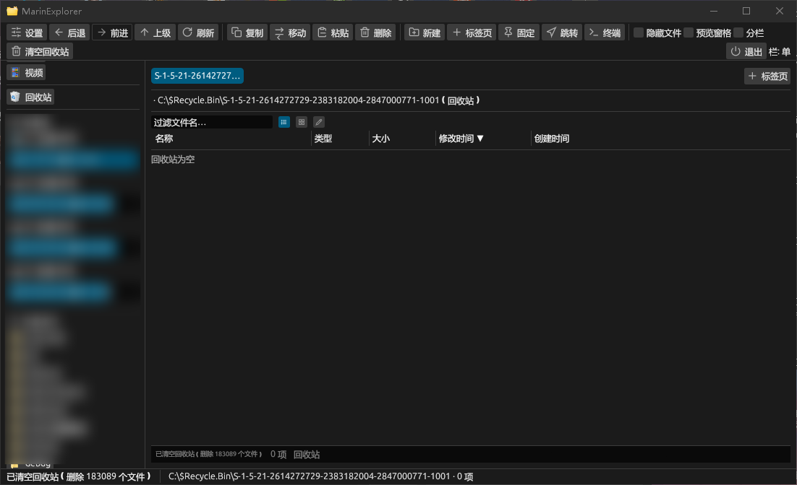

# MarinExplorer

<p align="center"></p>

一个轻量、支持 Windows on ARM64、基于 Rust + egui 的双栏文件管理器 / A lightweight, Windows-on-ARM64-capable, Rust + egui based two-pane file manager.

- 中文文档 ↓ [中文文档](#中文文档)
- English documentation ↓ [English Documentation](#english-documentation)

---

## 更新日志 / Changelog

### v0.1.13 — 2026-10-26
- **视频预览 / 播放器**：双击视频（MP4 / MOV / AVI / WMV / H.264 / HEVC / VP9 等）直接在查看器里播放。基于 Windows 自带的 Media Foundation，不捆绑任何解码器或播放器内核（exe 体积不变、无授权问题）。画面正中有暂停/播放键，底部是可拖拽的进度条 + 时间码；点画面正中即暂停/播放，拖动进度条可任意跳转。MKV / WebM / FLV 等 MF 不支持的格式会明确提示「无法解码」，不会卡住。
- **GIF 播放器**：GIF 不再当静态图片显示——有播放/暂停键、可拖拽的帧进度条和帧计数；点画面正中同样可播放/暂停。整段解码改为「首帧海报优先」：先瞬时显示第一帧，解码在后台继续，不再干等「正在准备 GIF」。
- **性能档（设置 → 性能 → 小 / 中 / 大）**：全局控制所有耗 CPU 的地方，不只查看器——后台重绘频率、进度轮询、文件夹大小扫描间隔与并发、网格缩略图解码、查看器播放节奏。**小（最低开销）**：网格不再新生成缩略图（已缓存的照常显示，直接显示文件类型图标）、大小扫描放到最慢、各类轮询降到约 5 次/秒，适合后台常驻；**中（均衡）**为默认；**大（最流畅）**按最高帧率跑。切换即时生效并记住。
- **播放 CPU 开销大幅下降**：GIF 纹理只在帧变化时才上传 GPU（原来每帧重建并重传约 1 MB 像素数据），重绘也改按 GIF 自身帧延迟调度，不再固定 60 fps 空转。侧边预览的 GIF 同样处理。
- **修复**：拖动视频进度条后画面又跳回开头（后台解码的旧帧会冲掉播放头）、点「下一张」到视频时不自动续播、GIF 暂停后按钮点不动、GIF 一直卡在「正在准备 GIF」。

**English**
- **Video preview / player**: double-click a video (MP4 / MOV / AVI / WMV / H.264 / HEVC / VP9 …) and it plays right in the viewer. Built on Windows' own Media Foundation — no bundled decoder, no bundled player core (exe size unchanged, no licensing concerns). A pause/play button sits at the centre of the picture, with a draggable progress bar and timecode at the bottom; click the centre to pause/resume, drag the bar to seek anywhere. Formats MF cannot decode (MKV / WebM / FLV …) say "cannot decode" instead of hanging.
- **GIF player**: GIFs are no longer treated as still images — they get a play/pause button, a draggable frame scrubber and a frame counter, and clicking the centre of the picture toggles playback. Whole-file decoding is now poster-first: the first frame appears instantly while decoding continues in the background, so you no longer sit on "preparing GIF".
- **Performance mode (Settings → Performance → Low / Medium / High)**: a global throttle over everything CPU-hungry, not just the viewer — background repaint rate, progress polling, folder-size scan interval and concurrency, grid thumbnail decoding, viewer playback cadence. **Low (least CPU)**: the grid stops generating new thumbnails (already-cached ones still show; everything else shows its file-type icon), size scanning runs at the slowest cadence, and polling drops to about 5 times a second — good for leaving it running in the background. **Medium (balanced)** is the default; **High (smoothest)** runs at the fastest rate. Switching applies instantly and is remembered.
- **Much lower playback CPU cost**: GIF textures upload to the GPU only when the frame actually changes (the old code rebuilt and re-uploaded ~1 MB of pixels every frame), and repaints are scheduled by the GIF's own frame delay instead of a fixed 60 fps spin. The side-pane GIF preview got the same treatment.
- **Fixes**: dragging a video's progress bar no longer snaps back to the start (stale decoded frames used to overwrite the playhead), clicking "next" onto a video now auto-plays it, the GIF pause button responds after pausing, and GIFs no longer stick on "preparing GIF".

### v0.1.12 — 2026-10-25
- **列表 / 网格视图虚拟化**：超大文件夹（如 5 万条图片+视频）不再逐帧重排全部条目。每帧只布局视口内可见行（屏外行只占位、不建单元格、不解析图标），每帧工作量从 O(5万) 降到 O(约 50 行)。拖动窗口、整体响应、以及打开查看器后的所有操作都恢复流畅。
- **双击打开不再整目录重读**：查看器的图片列表直接复用面板已加载的 `entries`，不再每次 `read_dir` 重新扫整目录。双击打开从几百 ms 降到近乎即时。

**English**
- **Virtualized list / grid views**: very large folders (e.g. 50k images + videos) no longer re-layout every entry each frame. Each frame now lays out only the rows visible in the viewport (off-screen rows are placeholders — no cells, no icon resolution), dropping per-frame work from O(50k) to O(~50 rows). Dragging the window, general responsiveness, and every action inside the opened viewer are smooth again.
- **Double-click no longer re-reads the whole directory**: the viewer's image list reuses the panel's already-loaded `entries` instead of `read_dir`'ing the folder on every open. Double-click open goes from hundreds of ms to near-instant.

### v0.1.11 — 2026-10-25
- **字体下拉读系统全部字体**：原本只列 8 个写死的字体，现在展开下拉时扫描 `%WINDIR%\Fonts` 下所有 `.ttf/.ttc/.otf/.otc`，用字体名表的真实家族名（按界面语言优先、回退英文）列出本机安装的全部字体，按名称排序。旧版本保存的字体偏好（短键名）会自动迁移成文件名。
- **默认字号调大**：未手动调过字号时，默认从 `1.0×` 提到 `1.12×`（约 +12%）；字号滑块上限从 `1.6×` 放宽到 `2.0×`，方便继续放大。
- **驱动器容量文案压缩**：左栏进度条与右侧磁盘详情里的「共 … · 剩 …」改为紧凑的「共…/剩…」（去空格、去中间点），避免文字过长超出范围；`human_size` 不再在数字与单位之间留空格。

**English**
- **Font picker now lists every system font**: previously it only offered 8 hard-coded faces. Opening the dropdown now scans `%WINDIR%\Fonts` for every `.ttf/.ttc/.otf/.otc`, reads each file's real family name (UI language first, English fallback) and lists all installed fonts sorted by name. Legacy font preferences (short keys) are migrated to file names automatically.
- **Larger default font size**: when the size has never been changed by hand, the default rises from `1.0×` to `1.12×` (~+12%); the size slider's upper bound is widened from `1.6×` to `2.0×` for even larger text.
- **Compact drive-capacity text**: the "共 … · 剩 …" labels in the left sidebar bar and the right-side disk panel are now "共…/剩…" (no spaces, no middle dot) so the text no longer overflows; `human_size` no longer puts a space between the number and the unit.

### v0.1.10 — 2026-10-24
- **预览 / 查看器不再卡死**：千张图片的文件夹里，网格缩略图不再一次性塞满解码队列。解码改为优先级队列——预览窗格里选中的图、查看器里正在看的大图为 `Urgent` 立即解码，胶片条 ±5 为 `Film`，网格缩略图最低优先且只解码视口内可见的。点图 / 双击立即出图，不再被整文件夹缩略图堵死。
- **查看器胶片条移到窗口底部**：小预览条之前画在顶部压住大图，现在落到大图下方预留的区域。

**English**
- **Previews / viewer no longer hang**: in a folder with thousands of images the grid no longer floods the decode queue. The decoder is now a priority queue — the image selected in the preview pane and the one shown large in the viewer decode as `Urgent` immediately, the filmstrip ±5 as `Film`, and grid thumbnails are lowest priority and only decode what is visible in the viewport. Clicking or double-clicking shows the image at once instead of being blocked behind the whole folder.
- **Viewer filmstrip moved to the bottom**: the small-preview strip used to paint on top of the large image; it now sits in the reserved area below it.

### v0.1.9 — 2026-10-23
- **修复 v0.1.8 安装失败**：v0.1.8 把 `DefaultGroupName` 误写成路径（`{userprograms}\MarinExplorer`）。管理安装模式下 Inno 会把它拼到 `{commonprograms}` 后面，展开的绝对路径里带冒号，`CreateDirectory` 直接报「文件名称不能包含下列任何字符」导致安装中断。现改为：`DefaultGroupName` 只用纯名称；开始菜单快捷方式在 `[Icons]` 里直写 `{userprograms}`，保证条目留在当前用户的开始菜单（与每用户安装位置一致），不再依赖 `{group}`。

**English**
- **Fixed the v0.1.8 install failure**: v0.1.8 mistakenly set `DefaultGroupName` to a path (`{userprograms}\MarinExplorer`). In administrative install mode Inno appends that value to `{commonprograms}`, so the expanded absolute path embedded a `:` in a directory name and `CreateDirectory` failed with "A filename cannot contain any of the following characters", aborting the install. Now `DefaultGroupName` is a plain name only, and the Start-menu shortcuts are written explicitly to `{userprograms}` in `[Icons]` — the entry stays in the installing user's Start Menu (matching the per-user install location) and no longer depends on `{group}`.

### v0.1.8 — 2026-10-23
- **安装包修复（升级不再被占用文件卡住）**：应用自 v0.1.5 起以管理员身份自提权运行，而安装包此前是「不提权」安装——中完整性的安装程序关不掉提权的旧实例（UIPI 拦截），覆盖安装时报「DeleteFile 失败；错误代码 5」。安装包现在同样以管理员身份运行（每次安装/升级一次 UAC 确认，与应用每次启动的自提权一致），升级时 Inno 会自动关闭正在运行的旧版，不再弹文件占用对话框。安装位置仍是每用户目录，开始菜单条目也仍只属当前用户。

**English**
- **Installer fix (upgrades no longer stall on a locked file)**: the app has self-elevated (runas) since v0.1.5, while the installer ran unelevated — a medium-integrity setup cannot close an elevated instance (UIPI blocks it), so upgrading over a running app failed with "DeleteFile failed; error code 5". The installer now runs elevated too (one UAC prompt per install/upgrade, same as the app's own self-elevation), and Inno's CloseApplications shuts the running old version down before replacing the exe — no more file-in-use dialog. The install location stays per-user, and the Start-menu entry stays in the current user's group.

### v0.1.7 — 2026-10-23
- **单实例守卫**：重复启动不再打开第二个窗口——新进程把路径交给已运行的实例并激活它的窗口（用文件投递代替 `WM_COPYDATA`，绕过 UIPI 对提权窗口的拦截）。托盘「重启」改为接管模式（`--take-over`）：重启后直接替换旧窗口，不再留下一个空窗口。
- **大小计算框常驻**：手动点「重新计算大小」后，左下角的框不再中途消失——完成后固定显示「大小计算完成 · 耗时 X · 已扫 Y」，直到下一次计算；也不再覆盖最左侧的操作日志。
- **启动更安静**：不再显示「已加载 N 个系统快速访问文件夹」这类一次性启动信息，底栏保留默认的快捷键提示。
- 文档补充「建议固定到任务栏」。

**English**
- **Single-instance guard**: launching again no longer opens a second window — the new process hands its path to the running instance and activates its window (via a file drop instead of `WM_COPYDATA`, so UIPI cannot block messages to the elevated window). The tray "restart" now takes over (`--take-over`): it replaces the old window instead of leaving an empty one behind.
- **Persistent size box**: after a manual "recompute sizes" the bottom-left box no longer vanishes mid-scan — it finishes with "sizes recomputed · took X · scanned Y" and stays until the next run, without overwriting the operation log.
- **Quieter startup**: the one-shot "loaded N system Quick Access folders" message is gone; the status bar keeps its default shortcut hints.
- Docs now suggest pinning the app to the taskbar.

### v0.1.6 — 2026-10-23
- **清空回收站重构**：不再调用 `SHEmptyRecycleBin`（系统会在删除前枚举并重新计算总大小，数万乃至数十万文件时正是资源管理器卡死/无法删除的根因）。改为直接遍历自己 SID 下的 `$Recycle.Bin\{SID}`，边删 `$I`/`$R` 边计数，底部进度条显示真实百分比 + 「已删除 N」，不再卡顿，也不会因系统枚举失败而删不掉。
- **下载指引**：普通 Windows x64 用户请下载 `MarinExplorer-Setup-Windows-x64-msvc-0.1.6.exe`；ARM 架构的 Windows（如 Surface、骁龙平板/笔记本）请下载 `MarinExplorer-Setup-Windows-arm64-0.1.6.exe`。两者不可混用，安装包已按架构限制。

**English**
- **Recycle Bin empty reworked**: no longer calls `SHEmptyRecycleBin` (which enumerates and recomputes total size before deleting — the exact cause of File Explorer's freeze / failure at tens-to-hundreds of thousands of items). It now walks your own `$Recycle.Bin\{SID}` and deletes the `$I`/`$R` pairs while counting, with a real percentage + "deleted N" in the bottom bar — no stall, and it can't fail to delete because of the shell's enumeration.
- **Download note**: regular Windows x64 users grab `MarinExplorer-Setup-Windows-x64-msvc-0.1.6.exe`; ARM Windows (e.g. Surface, Snapdragon tablet/laptop) grab `MarinExplorer-Setup-Windows-arm64-0.1.6.exe`. They are not interchangeable — each installer is architecture-locked.

### v0.1.5 — 2026-10-23
- 左侧「快速访问」已固定的桌面 / 下载 / 文档等条目改用系统真实（彩色）图标，与文件夹主区域一致；移除了冗余的「常用位置」分组。
- 顶部工具栏「移动」改为「剪贴」，图标换成剪刀，相关提示文案同步更新。
- 清空回收站不再弹出系统进度框（数万文件下会卡顿），改为后台线程执行 + 底部不确定的动画进度条，系统调用返回后自动消失。

**English**
- Quick-access pinned items (Desktop / Downloads / Documents…) now use the system's real (full-colour) icons, matching the main pane; the redundant "Common locations" group was removed.
- Toolbar "Move" renamed to "Cut" with a scissors icon; status text updated accordingly.
- Emptying the Recycle Bin no longer shows the system progress dialog (which can hang with tens of thousands of files); it runs on a background thread with an indeterminate animated progress bar at the bottom and disappears once the system call returns.

---

## 中文文档

一个**轻量、支持 Windows on ARM64、基于 Rust + [egui](https://github.com/emilk/egui) 的双栏文件管理器**。

**仅支持 Windows**——`x86_64`（标准 Windows 64 位）与 `aarch64`（Windows on ARM64，如 Surface / 骁龙笔记本）。不提供 Linux 或 macOS 版本。

### 运行

**安装包（推荐）**：从 **Releases** 下载 `MarinExplorer-Setup-Windows-<架构>-<版本>.exe`（x64 选 `x64-msvc`，ARM64 选 `arm64`），一路「下一步」即可。安装向导提供三个选项：

- ☑ 加入开始菜单（默认勾选）
- ☑ 在右键菜单中加入「通过 MarinExplorer 打开」（默认勾选）
- ☐ 创建桌面快捷方式

安装程序会请求一次管理员确认（UAC）：升级时靠它自动关闭正在运行的旧版，避免「文件被占用、替换失败」。安装位置仍是每用户目录，开始菜单条目也只属当前用户。

安装目录可自行更改，默认是 `%LOCALAPPDATA%\Programs\MarinExplorer`。之所以不用 Program Files：MarinExplorer 把文件夹大小缓存写在**自己的安装目录**里以保持自包含，而 Program Files 没有管理员权限就写不进去。若希望完全不碰 C 盘，安装时改成 `D:\Programs\MarinExplorer` 之类即可。

**绿色免安装**：Releases 只提供安装包。若想要单个 `.exe`，可到 **Actions → 对应运行 → Artifacts** 下载 `MarinExplorer-x64-msvc.exe`（x64）或 `MarinExplorer-arm64.exe`（ARM64），放到任意位置运行。右键菜单的开关就摆在**设置**里，随时可以自己打开或关掉。

首次打开会读取并缓存磁盘信息，之后都很快。

💡 **建议以管理员身份运行**：访问受保护的系统目录、写入系统路径时，管理员权限能避免因权限不足导致的功能受限。

📌 **建议固定到任务栏**：安装后右键开始菜单（或桌面）里的 MarinExplorer 图标 →「固定到任务栏」，之后随点随用，不必每次翻开始菜单。

🔒 **安全提醒**：请只从本仓库的 **Releases** 或官方构建渠道获取 `MarinExplorer.exe`。不要从不明来源下载，以免被植入木马或后门。

### 截图

<p align="center"></p>

### 它解决了什么

1. **资源占用太大** — 资源管理器偏重。MarinExplorer 用 Rust + egui 自绘 UI，常驻内存远低于系统资源管理器，在内存吃紧的 ARM64 设备上差别尤其明显。
2. **回收站卡死** — 回收站里堆到数万文件时，资源管理器要花特别久才能读出列表，删除更是近乎不可用。这里把 `$Recycle.Bin` 里 `$I` 文件的解析丢到**后台线程**，界面不等它、全程可操作；清空后自动刷新，侧边栏图标随「满 / 空」变化。清空回收站也重写过：不再调用系统的 `SHEmptyRecycleBin`（它要先枚举并重算总大小，数十万文件时正是资源管理器卡死/删不掉的根因），而是直接遍历自己账户的 `$Recycle.Bin` 流式删除，底部进度条显示**真实百分比 + 已删除数量**，全程不卡、也不会删不掉。
3. **图片预览各自为政** — 每台设备装了不同的看图软件，双击一张 PNG 会拉起不同的程序，各自再占一份内存。内置预览面板在同一个窗口里直接看图，不必再启动别的应用。
4. **图片转 ICO 麻烦** — 开发软件要给应用做图标时，往往得去找在线转换站或额外装工具。在预览器里右键「转换为 ICO」，直接把当前图片（可拖拽框选方形裁切区域）导出成**一个**多尺寸 `.ico`（16 / 24 / 32 / 48 / 64 / 128 / 256 任选），落回原图所在目录。
5. **图片压缩 / 转 PNG** — 右键「转换为 PNG」，可选 0–9 的压缩级别（0 = 不压缩，9 = 最小），导出到新文件夹，避免同名覆盖源文件。

当前形态：一个基于 Rust + egui 的 Windows 桌面文件管理器，专注「能用、顺手」而非功能堆砌，原生支持 Windows on ARM64（msvc）。

### 功能

**双栏浏览**
- 左右两个**互相独立**的文件面板，各自维护：当前目录、筛选、排序、历史。
- 顶部工具栏：`返回 / 前进 / 上级 / 刷新 / 复制 / 移动 / 粘贴 / 删除 / 新建文件夹 / 跳转 / 终端 / 显示隐藏文件`。

**侧边栏**
- 回收站入口（列表后台异步加载，不卡 UI；清空后自动刷新，图标随满/空状态变化；清空为流式自删，底部显示真实进度）。
- 固定磁盘列表，带**剩余 / 总量**空间显示。
- 主页（Home）快捷入口。

**预览与图片工具**
- 内置图片预览面板，支持 PNG / JPEG / BMP / ICO / TIFF / WebP / GIF。
- 缩略图网格视图。
- **转换为 ICO**：拖拽框选方形区域，勾选需要的尺寸（16 / 24 / 32 / 48 / 64 / 128 / 256），导出**单个**多尺寸 `.ico` 到原图所在目录（Vista+ 格式，内嵌 PNG 载荷）。
- **转换为 PNG**：可选 0–9 压缩级别（0 = 不压缩，9 = 最小），导出到新文件夹，不会覆盖同名源文件。

**拖拽与外壳集成**
- 从面板**拖出文件**到外部程序。
- 使用系统**真实文件图标**（shell icon），而不是自己画一套。
- 支持 Windows 原生：深色标题栏、应用图标、系统托盘常驻。
- **右键菜单集成**：「通过 MarinExplorer 打开」可出现在文件、文件夹、磁盘以及文件夹空白处，开关在设置里（也由安装包代为注册）。只写 `HKCU` 当前用户 hive，**不需要管理员权限**，随时可关。

**性能与体验**
- 文件夹大小在**后台线程**计算，并持久化到磁盘（`<安装目录>\MarinExplorer\store.txt`，即 `.exe` 所在文件夹内），重开即秒显。程序不会往系统盘或用户目录里丢任何东西；只有安装目录不可写时（例如装在系统保护区）才回退到 `%LOCALAPPDATA%\MarinExplorer`。
- 底部状态栏：状态、当前路径、条目数、任务进度。
- 多语言界面：**简体中文 / English / 日本語 / 繁體中文**。
- 亮色 / 暗色主题；中文用 **Windows 系统字体**（微软雅黑优先，运行时从 `%WINDIR%\Fonts` 加载，不打包进 exe），观感与系统一致且不乱码。

**键盘**
`↑/↓` 选择 · `Enter` 打开 · `Home/End` 跳首尾 · `Delete` 删除 · `Alt+←/→` 后退/前进 · `Esc` 关闭弹窗。

### 构建

需要 Rust 工具链。本项目只产出 **Windows** 可执行文件，两个目标：

- `x86_64-pc-windows-msvc` —— 标准 Windows x64，使用 MSVC。
- `aarch64-pc-windows-msvc` —— Windows on ARM64（如 Surface / 骁龙笔记本），使用 MSVC。

```bash
# 默认目标
cargo build --release

# Windows x64（msvc）
cargo build --release --target x86_64-pc-windows-msvc

# Windows on ARM64（msvc）
cargo build --release --target aarch64-pc-windows-msvc
```

产物：
- `target/x86_64-pc-windows-msvc/release/MarinExplorer.exe`
- `target/aarch64-pc-windows-msvc/release/MarinExplorer.exe`

说明：
- 发布构建已为体积优化（`opt-level = "z"` + LTO + strip）。
- 应用图标由 `build.rs` 用 Windows SDK 的 `rc.exe` 编进 Windows 资源，产物自带文件图标；找不到资源编译器时编译照常通过，只是没有文件图标。
- 代码签名（可选）见 `sign.ps1`：用受信任 CA 的 `.pfx` 给 exe 签名 + 时间戳，消除 SmartScreen 拦截。
- **Releases 只提供 MSVC 构建的安装包**（已静态链接 C 运行时，无需安装 VC++ 运行库）。

### 自动构建（GitHub Actions）

仓库已在每次推送 `main` 时通过 GitHub Actions 自动编译 **两个 Windows 版本**（均在 Windows runner 上用原生 MSVC 工具链编译，静态链接 C 运行时，目标机器无需安装 VC++ 可再发行组件）：

- `x86_64-pc-windows-msvc`（标准 Windows x64，MSVC）
- `aarch64-pc-windows-msvc`（Windows on ARM64，MSVC）

工作流见 [`.github/workflows/build.yml`](.github/workflows/build.yml)。裸 `.exe` 产物（`MarinExplorer-x64-msvc.exe` / `MarinExplorer-arm64.exe`）可在 **Actions → 对应运行 → Artifacts** 下载；打 `v*` 标签推送时，会把两个 Inno Setup 安装包（`MarinExplorer-Setup-Windows-x64-msvc-<版本>.exe` / `MarinExplorer-Setup-Windows-arm64-<版本>.exe`）发布到 **Releases**——Releases 只提供安装包，不提供裸 exe。

### 许可证

[MIT](./LICENSE) © 2026 Rei1mu

自由使用、修改、再分发，只需保留版权声明。

---

## English Documentation

A **lightweight, Windows-on-ARM64-capable, Rust + [egui](https://github.com/emilk/egui) based two-pane file manager**.

**Windows only** — `x86_64` (standard 64-bit Windows) and `aarch64` (Windows on ARM64, e.g. Surface / Snapdragon laptops). No Linux or macOS builds.

### Usage

**Installer (recommended)**: download `MarinExplorer-Setup-Windows-<arch>-<version>.exe` from **Releases** (`x64-msvc` for x64, `arm64` for ARM64) and click through. The wizard offers three options:

- ☑ Add to Start menu (checked by default)
- ☑ Add "Open with MarinExplorer" to the right-click menu (checked by default)
- ☐ Create a desktop shortcut

Setup asks for one administrator confirmation (UAC): on upgrades it is used to close the running old version automatically, so the exe is never "in use". The install location stays per-user, and the Start-menu entry stays in the current user's group.

You may change the install directory; the default is `%LOCALAPPDATA%\Programs\MarinExplorer`. Program Files is deliberately not the default: MarinExplorer keeps its folder-size cache **inside its own install directory** to stay self-contained, and Program Files is not writable without elevation. If you want nothing on `C:`, point the installer at something like `D:\Programs\MarinExplorer`.

**Portable**: Releases only ship the installer. If you want a bare `.exe`, grab `MarinExplorer-x64-msvc.exe` (x64) or `MarinExplorer-arm64.exe` (ARM64) from **Actions → run → Artifacts** and run it from anywhere. The context-menu switch lives in **Settings**, so you can turn it on or off at any time.

The first open reads and caches disk info; afterwards it's fast.

💡 **Run as Administrator** is recommended: it avoids permission errors when reaching protected system folders or writing to system paths.

📌 **Pin it to the taskbar**: after install, right-click the MarinExplorer icon in the Start menu (or on the desktop) → "Pin to taskbar", so it's one click away every time.

🔒 **Security**: only download `MarinExplorer.exe` from this repo's **Releases** or official build artifacts. Do not fetch it from unknown sources — that's how trojans and backdoors get in.

### Screenshot

<p align="center"></p>

### What It Fixes

1. **Too much resource usage** — Explorer is heavy. MarinExplorer draws its own UI with Rust + egui and stays resident for far less memory than Explorer, which is especially noticeable on memory-tight ARM64 devices.
2. **A frozen Recycle Bin** — once the bin holds tens of thousands of entries, Explorer takes ages just to list it, and deleting is close to unusable. Here the `$I` file parsing inside `$Recycle.Bin` runs on a **background thread**: the UI never waits for it and stays usable the whole time. Emptying auto-refreshes the listing, and the sidebar icon tracks full/empty. Emptying was reworked too: it no longer calls `SHEmptyRecycleBin` (which enumerates and recomputes total size first — the exact cause of the freeze / delete-failure at hundreds of thousands of items); it streams the deletion of your own `$Recycle.Bin` directly, with a **real percentage + deleted count** in the bottom bar, so it never stalls and never fails to delete.
3. **Every machine previews images differently** — each device has its own photo viewer installed, so double-clicking a PNG launches a different program each time, each costing another slice of memory. The built-in preview panel shows images inside the same window; nothing else needs to start.
4. **Image-to-ICO is a hassle** — shipping an app means shipping an icon, which usually means hunting for an online converter or installing extra tooling. Right-click in the viewer → "Convert to ICO" exports the current picture (optionally cropped to a dragged square region) as **one** multi-size `.ico` (pick from 16 / 24 / 32 / 48 / 64 / 128 / 256), written next to the source image.
5. **Image compression / PNG export** — "Convert to PNG" offers deflate levels 0–9 (0 = none, 9 = smallest) and writes into a new folder, so it can never overwrite the same-named source.

Current form: a Rust + egui Windows desktop file manager focused on "works and feels right" rather than feature count, with native support for Windows on ARM64 (MSVC).

### Features

**Two-pane browsing**
- Two **independent** panels, each keeping its own directory, filter, sort order and history.
- Toolbar: back / forward / up / refresh / copy / move / paste / delete / new folder / jump / terminal / show hidden.

**Sidebar**
- Recycle Bin entry (loaded async in the background; auto-refreshes after emptying, icon reflects full/empty; emptying streams the delete with a real progress bar).
- Fixed drive list with **free / total** space.
- Home shortcut.

**Preview & image tools**
- Built-in image preview: PNG / JPEG / BMP / ICO / TIFF / WebP / GIF.
- Thumbnail grid view.
- **Convert to ICO**: drag a square crop region, tick the sizes you need (16 / 24 / 32 / 48 / 64 / 128 / 256), and export a **single** multi-size `.ico` next to the source (Vista+ format, PNG payloads inside).
- **Convert to PNG**: choose a deflate level 0–9 (0 = none, 9 = smallest); output goes into a new folder so the same-named source is never overwritten.

**Drag & shell integration**
- Drag files **out** of a panel into other apps.
- Uses the system's **real file icons** (shell icons), not a hand-drawn set.
- Native Windows: dark title bar, app icon, system tray resident.
- **Right-click menu integration**: "Open with MarinExplorer" can appear on files, folders, drives and empty folder space, toggled from Settings (and registered for you by the installer). It only writes the current-user `HKCU` hive — **no administrator rights**, and it can be switched off at any time.

**Performance & UX**
- Folder sizes computed in a **background thread** and persisted to disk (`<install dir>\MarinExplorer\store.txt`, i.e. right next to the `.exe`) for instant reload. Nothing is written to the system drive or your user profile; only if the install directory is not writable does it fall back to `%LOCALAPPDATA%\MarinExplorer`.
- Status bar: state, current path, item count, task progress.
- UI languages: Simplified Chinese / English / Japanese / Traditional Chinese.
- Light / dark theme; Chinese uses the **Windows system font** (Microsoft YaHei first, loaded at runtime from `%WINDIR%\Fonts` — not bundled), so it matches the OS look and never mojibakes.

**Keyboard**
`↑/↓` select · `Enter` open · `Home/End` jump to top/bottom · `Delete` delete · `Alt+←/→` back/forward · `Esc` close dialog.

### Build

Requires the Rust toolchain. This project builds **Windows** executables only, for two targets:

- `x86_64-pc-windows-msvc` — standard Windows x64, built with MSVC.
- `aarch64-pc-windows-msvc` — Windows on ARM64 (e.g. Surface / Snapdragon laptops), built with MSVC.

```bash
# default target
cargo build --release

# Windows x64 (msvc)
cargo build --release --target x86_64-pc-windows-msvc

# Windows on ARM64 (msvc)
cargo build --release --target aarch64-pc-windows-msvc
```

Artifacts:
- `target/x86_64-pc-windows-msvc/release/MarinExplorer.exe`
- `target/aarch64-pc-windows-msvc/release/MarinExplorer.exe`

Notes:
- Release builds are size-optimized (`opt-level = "z"` + LTO + strip).
- The app icon is embedded by `build.rs` via the Windows SDK `rc.exe`, so the exe carries a file icon; if no resource compiler is found the build still succeeds, just without a file icon.
- Optional code signing lives in `sign.ps1`.
- **Releases ship MSVC installers only** (statically linked C runtime — no VC++ redistributable needed).

### Automated Builds (GitHub Actions)

On every push to `main`, GitHub Actions automatically builds **two Windows editions** (both compiled on a Windows runner with the native MSVC toolchain and a statically linked C runtime — no "Visual C++ Redistributable" needed on the target machine):

- `x86_64-pc-windows-msvc` (standard Windows x64, MSVC)
- `aarch64-pc-windows-msvc` (Windows on ARM64, MSVC)

Workflow: [`.github/workflows/build.yml`](.github/workflows/build.yml). The bare `.exe` artifacts (`MarinExplorer-x64-msvc.exe` / `MarinExplorer-arm64.exe`) are downloadable from **Actions → run → Artifacts**; pushing a `v*` tag publishes the two Inno Setup installers (`MarinExplorer-Setup-Windows-x64-msvc-<version>.exe` / `MarinExplorer-Setup-Windows-arm64-<version>.exe`) to **Releases** — Releases carries installers only, no bare exes.

### License

[MIT](./LICENSE) © 2026 Rei1mu

Free to use, modify, and redistribute — just keep the copyright notice.
