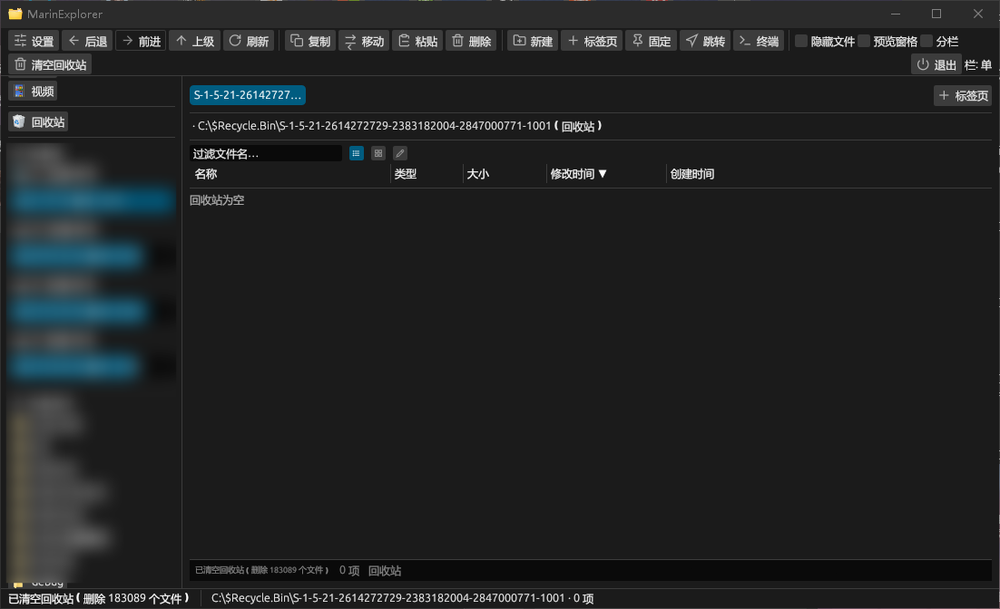

# MarinExplorer

<p align="center"></p>

一个轻量、支持 Windows on ARM64、基于 Rust + egui 的双栏文件管理器 / A lightweight, Windows-on-ARM64-capable, Rust + egui based two-pane file manager.

- 中文文档 ↓ [中文文档](#中文文档)
- English documentation ↓ [English Documentation](#english-documentation)

---

## 更新日志 / Changelog

> 完整版本记录见 [CHANGELOG.md](./CHANGELOG.md)。

## 中文文档

一个**轻量、支持 Windows on ARM64、基于 Rust + [egui](https://github.com/emilk/egui) 的双栏文件管理器**。

**仅支持 Windows**——`x86_64`（标准 Windows 64 位）与 `aarch64`（Windows on ARM64，如 Surface / 骁龙笔记本）。不提供 Linux 或 macOS 版本。

### 运行

**安装包（推荐）**：从 **Releases** 下载 `MarinExplorer-Setup-Windows-<架构>-<版本>.exe`（x64 选 `x64-msvc`，ARM64 选 `arm64`），一路「下一步」即可。安装向导提供三个选项：

- ☑ 加入开始菜单（默认勾选）
- ☑ 在右键菜单中加入「通过 MarinExplorer 打开」（默认勾选）
- ☐ 创建桌面快捷方式

安装程序会请求一次管理员确认（UAC）：升级时靠它自动关闭正在运行的旧版，避免「文件被占用、替换失败」。安装位置仍是每用户目录，开始菜单条目也只属当前用户。

安装目录可自行更改，默认是 `%LOCALAPPDATA%\Programs\MarinExplorer`。之所以不用 Program Files：MarinExplorer 把文件夹大小缓存写在**自己的安装目录**里以保持自包含，而 Program Files 没有管理员权限就写不进去。若希望完全不碰 C 盘，安装时改成 `D:\Programs\MarinExplorer` 之类即可。

**绿色免安装**：Releases 只提供安装包。若想要单个 `.exe`，可到 **Actions → 对应运行 → Artifacts** 下载 `MarinExplorer-x64-msvc.exe`（x64）或 `MarinExplorer-arm64.exe`（ARM64），放到任意位置运行。右键菜单的开关就摆在**设置**里，随时可以自己打开或关掉。

首次打开会读取并缓存磁盘信息，之后都很快。

💡 **权限说明**：默认以普通用户权限运行——复制粘贴、拖拽文件到浏览器或 QQ 都要求与对方同一权限级别，提权反而会让外部程序读不到本程序放上剪贴板的内容。确需访问受保护的系统目录时，右键以管理员身份运行即可（此时复制到外部程序会受限）。

📌 **建议固定到任务栏**：安装后右键开始菜单（或桌面）里的 MarinExplorer 图标 →「固定到任务栏」，之后随点随用，不必每次翻开始菜单。

🔒 **安全提醒**：请只从本仓库的 **Releases** 或官方构建渠道获取 `MarinExplorer.exe`。不要从不明来源下载，以免被植入木马或后门。

### 截图

<p align="center"></p>

### 它解决了什么

- **轻量**：Rust + egui 自绘，常驻内存远低于系统资源管理器，对 ARM64 设备尤其明显。
- **回收站不卡死**：`$Recycle.Bin` 解析与清空都在后台 / 流式完成，界面全程可操作。
- **预览统一**：内置看图与媒体播放，不必为每张图、每段视频拉起别的程序。

### 功能

- **双栏文件管理**：左右独立面板（各自目录 / 筛选 / 排序 / 历史）+ 完整工具栏。
- **回收站**：后台异步加载、流式清空并显示真实进度。
- **图片预览与转换**：内置看图、缩略图网格；右键转 ICO（拖拽裁切）/ PNG（0–9 压缩）。
- **PDF 预览**：预览窗格 / 网格缩略图 / 全屏窗口均渲染首页；纯 Rust 渲染器编进 exe，无需外部 DLL。
- **视频 / GIF 播放器**：基于 Windows Media Foundation，不捆绑解码器；播放/暂停、进度条、帧进度。
- **拖出文件**：拖到浏览器 / QQ / 资源管理器，完整 `IDropSource`，稳定不崩。
- **外壳集成**：系统真实图标、深色标题栏、托盘常驻、右键「通过 MarinExplorer 打开」。
- **性能**：性能模式（低 / 中 / 高）、超大文件夹虚拟化、优先解码队列、后台算大小并持久化。
- **键盘与交互**：Ctrl+C/X/V 与资源管理器互通、Delete 确认、实时按键回显、单实例守卫。
- **多语言 / 主题**：简中 / 英 / 日 / 繁中，亮暗主题，系统字体。
- **默认普通用户权限**：复制粘贴 / 拖拽到外部可用，仅清空回收站等按需提权。

### 构建

需要 Rust 工具链。本项目只产出 **Windows** 可执行文件，两个目标：

- `x86_64-pc-windows-msvc` —— 标准 Windows x64，使用 MSVC。
- `aarch64-pc-windows-msvc` —— Windows on ARM64（如 Surface / 骁龙笔记本），使用 MSVC。

```bash
# 默认目标
cargo build --release

# Windows x64（msvc）
cargo build --release --target x86_64-pc-windows-msvc

# Windows on ARM64（msvc）
cargo build --release --target aarch64-pc-windows-msvc
```

产物：
- `target/x86_64-pc-windows-msvc/release/MarinExplorer.exe`
- `target/aarch64-pc-windows-msvc/release/MarinExplorer.exe`

说明：
- 发布构建已为体积优化（`opt-level = "z"` + LTO + strip）。
- 应用图标由 `build.rs` 用 Windows SDK 的 `rc.exe` 编进 Windows 资源，产物自带文件图标；找不到资源编译器时编译照常通过，只是没有文件图标。
- 代码签名（可选）见 `sign.ps1`：用受信任 CA 的 `.pfx` 给 exe 签名 + 时间戳，消除 SmartScreen 拦截。
- **Releases 只提供 MSVC 构建的安装包**（已静态链接 C 运行时，无需安装 VC++ 运行库）。

### 自动构建（GitHub Actions）

仓库已在每次推送 `main` 时通过 GitHub Actions 自动编译 **两个 Windows 版本**（均在 Windows runner 上用原生 MSVC 工具链编译，静态链接 C 运行时，目标机器无需安装 VC++ 可再发行组件）：

- `x86_64-pc-windows-msvc`（标准 Windows x64，MSVC）
- `aarch64-pc-windows-msvc`（Windows on ARM64，MSVC）

工作流见 [`.github/workflows/build.yml`](.github/workflows/build.yml)。裸 `.exe` 产物（`MarinExplorer-x64-msvc.exe` / `MarinExplorer-arm64.exe`）可在 **Actions → 对应运行 → Artifacts** 下载；打 `v*` 标签推送时，会把两个 Inno Setup 安装包（`MarinExplorer-Setup-Windows-x64-msvc-<版本>.exe` / `MarinExplorer-Setup-Windows-arm64-<版本>.exe`）发布到 **Releases**——Releases 只提供安装包，不提供裸 exe。

### 许可证

[MIT](./LICENSE) © 2026 Rei1mu

自由使用、修改、再分发，只需保留版权声明。

---

## English Documentation

A **lightweight, Windows-on-ARM64-capable, Rust + [egui](https://github.com/emilk/egui) based two-pane file manager**.

**Windows only** — `x86_64` (standard 64-bit Windows) and `aarch64` (Windows on ARM64, e.g. Surface / Snapdragon laptops). No Linux or macOS builds.

### Usage

**Installer (recommended)**: download `MarinExplorer-Setup-Windows-<arch>-<version>.exe` from **Releases** (`x64-msvc` for x64, `arm64` for ARM64) and click through. The wizard offers three options:

- ☑ Add to Start menu (checked by default)
- ☑ Add "Open with MarinExplorer" to the right-click menu (checked by default)
- ☐ Create a desktop shortcut

Setup asks for one administrator confirmation (UAC): on upgrades it is used to close the running old version automatically, so the exe is never "in use". The install location stays per-user, and the Start-menu entry stays in the current user's group.

You may change the install directory; the default is `%LOCALAPPDATA%\Programs\MarinExplorer`. Program Files is deliberately not the default: MarinExplorer keeps its folder-size cache **inside its own install directory** to stay self-contained, and Program Files is not writable without elevation. If you want nothing on `C:`, point the installer at something like `D:\Programs\MarinExplorer`.

**Portable**: Releases only ship the installer. If you want a bare `.exe`, grab `MarinExplorer-x64-msvc.exe` (x64) or `MarinExplorer-arm64.exe` (ARM64) from **Actions → run → Artifacts** and run it from anywhere. The context-menu switch lives in **Settings**, so you can turn it on or off at any time.

The first open reads and caches disk info; afterwards it's fast.

💡 **About permissions**: the app runs at normal user integrity by default — copy/paste and dragging files into browsers or QQ require the same integrity level on both sides, and elevating would make the clipboard unreadable to other programs. If you do need protected system folders, right-click and run as administrator (copying to external programs is limited in that mode).

📌 **Pin it to the taskbar**: after install, right-click the MarinExplorer icon in the Start menu (or on the desktop) → "Pin to taskbar", so it's one click away every time.

🔒 **Security**: only download `MarinExplorer.exe` from this repo's **Releases** or official build artifacts. Do not fetch it from unknown sources — that's how trojans and backdoors get in.

### Screenshot

<p align="center"></p>

### What It Fixes

- **Lightweight**: Rust + egui draws its own UI and stays resident for far less memory than Explorer — especially on ARM64.
- **No frozen Recycle Bin**: `$Recycle.Bin` parsing and emptying both run in the background / streamed, so the UI never blocks.
- **Unified preview**: a built-in viewer and media player, so you don't launch another app per image or video.

### Features

- **Two-pane file manager**: two independent panels (own directory / filter / sort / history) and a full toolbar.
- **Recycle Bin**: loaded async in the background; emptying streams the delete with a real progress bar.
- **Image preview & conversion**: built-in viewer, thumbnail grid; right-click convert to ICO (drag-crop) / PNG (deflate 0–9).
- **PDF preview**: the side pane, grid thumbnail and full viewer all render the first page; the pure-Rust rasterizer is compiled into the exe, no external DLL.
- **Video / GIF player**: built on Windows Media Foundation, no bundled decoder; play/pause, seek bar, frame scrubber.
- **Drag files out**: drag into browsers / QQ / Explorer via a complete `IDropSource`, stable and crash-free.
- **Shell integration**: real system icons, dark title bar, tray resident, "Open with MarinExplorer" context menu.
- **Performance**: performance mode (Low/Medium/High), virtualized views for huge folders, priority decode queue, background size scan persisted to disk.
- **Keyboard & interaction**: Ctrl+C/X/V interoperate with Explorer, Delete confirmation, live key echo, single-instance guard.
- **Languages / theme**: Simplified / Traditional Chinese, English, Japanese; light / dark theme; system font.
- **Normal user by default**: copy/paste and drag-out to other programs work; only a few actions (e.g. empty Recycle Bin) ask for elevation.

### Build

Requires the Rust toolchain. This project builds **Windows** executables only, for two targets:

- `x86_64-pc-windows-msvc` — standard Windows x64, built with MSVC.
- `aarch64-pc-windows-msvc` — Windows on ARM64 (e.g. Surface / Snapdragon laptops), built with MSVC.

```bash
# default target
cargo build --release

# Windows x64 (msvc)
cargo build --release --target x86_64-pc-windows-msvc

# Windows on ARM64 (msvc)
cargo build --release --target aarch64-pc-windows-msvc
```

Artifacts:
- `target/x86_64-pc-windows-msvc/release/MarinExplorer.exe`
- `target/aarch64-pc-windows-msvc/release/MarinExplorer.exe`

Notes:
- Release builds are size-optimized (`opt-level = "z"` + LTO + strip).
- The app icon is embedded by `build.rs` via the Windows SDK `rc.exe`, so the exe carries a file icon; if no resource compiler is found the build still succeeds, just without a file icon.
- Optional code signing lives in `sign.ps1`.
- **Releases ship MSVC installers only** (statically linked C runtime — no VC++ redistributable needed).

### Automated Builds (GitHub Actions)

On every push to `main`, GitHub Actions automatically builds **two Windows editions** (both compiled on a Windows runner with the native MSVC toolchain and a statically linked C runtime — no "Visual C++ Redistributable" needed on the target machine):

- `x86_64-pc-windows-msvc` (standard Windows x64, MSVC)
- `aarch64-pc-windows-msvc` (Windows on ARM64, MSVC)

Workflow: [`.github/workflows/build.yml`](.github/workflows/build.yml). The bare `.exe` artifacts (`MarinExplorer-x64-msvc.exe` / `MarinExplorer-arm64.exe`) are downloadable from **Actions → run → Artifacts**; pushing a `v*` tag publishes the two Inno Setup installers (`MarinExplorer-Setup-Windows-x64-msvc-<version>.exe` / `MarinExplorer-Setup-Windows-arm64-<version>.exe`) to **Releases** — Releases carries installers only, no bare exes.

### License

[MIT](./LICENSE) © 2026 Rei1mu

Free to use, modify, and redistribute — just keep the copyright notice.
